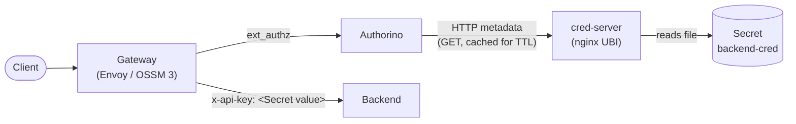

# Injecting a Kubernetes Secret value into a request header with Red Hat Connectivity Link

Proof of concept for injecting the value of a Kubernetes Secret into a header of every request forwarded to an
upstream service, regardless of the authenticated user, using only supported Red Hat Connectivity Link (RHCL)
components.

Validated on OpenShift 4.21.36, OpenShift Service Mesh 3.4.3 (Gateway API provider) and RHCL 1.4.4.

## Background

RHCL has no native way to use a Secret as a header value:

- `HTTPRoute` `RequestHeaderModifier` accepts literal values only.
- `AuthPolicy` `response.success.headers` injects values from the authorization JSON. Secrets reach that JSON only
  as API key identities, that is, the Secret of the client that authenticated.

Alternatives considered and discarded:

| Alternative | Reason |
|---|---|
| Value rendered into the AuthPolicy or HTTPRoute | The secret is stored in plain text in a CR, which is not covered by etcd encryption |
| `EnvoyFilter` | Developer Preview in OSSM 3, not supported |
| Custom `WasmPlugin` | Unsupported module; requires customizing the gateway pod |
| Standalone Envoy serving the credential | No supported Red Hat image for standalone use; no automatic rotation |
| `HTTPRouteFilter` with `credentialInjection` | Envoy Gateway CRD; not available with OSSM |

## Approach

A composition of documented resources:

1. **cred-server**: an nginx container (`registry.redhat.io/ubi9/nginx-124`) serves the Secret, mounted as a JSON
   file.
2. The **AuthPolicy** fetches the value from the cred-server through HTTP metadata, with a cache.
3. `response.success.headers` injects the value into the request sent upstream.
4. A **NetworkPolicy** allows only the Authorino pods to reach the cred-server. Without it, any pod in the cluster
   could read the credential and bypass the Secret's RBAC.



## Repository layout

```
manifests/
├── platform/        lab prerequisites; skip on clusters that already run RHCL and a Gateway
│   ├── 00-ossm3/    OSSM 3 operator, Istio and IstioCNI
│   ├── 01-rhcl/     RHCL operator and Kuadrant CR
│   └── 02-gateway/  Gateway "external" and an OpenShift Route to its service
├── solution/        the injection pattern itself
│   ├── 01-secret.yaml
│   ├── 02-cred-server.yaml
│   ├── 03-networkpolicy.yaml
│   └── 04-authpolicy.yaml
└── test-support/    test-only resources
    ├── 00-namespace.yaml
    ├── 01-echo-backend.yaml   echo service that returns the received headers
    └── 02-httproute.yaml      HTTPRoute targeted by the AuthPolicy
```

| Directory | Resources |
|---|---|
| `platform/00-ossm3/` | Subscription `servicemeshoperator3` (channel `stable-3.4`) in `openshift-operators`; `Istio` and `IstioCNI` in `istio-system` and `istio-cni` |
| `platform/01-rhcl/` | Namespace `kuadrant-system`, OperatorGroup, Subscription `rhcl-operator` (channel `stable-1.4`) and the `Kuadrant` CR |
| `platform/02-gateway/` | Namespace `api-gateway`, Gateway `external` (GatewayClass `istio`, ClusterIP service) and a Route to the gateway service |
| `solution/` | Secret `backend-cred`, cred-server (ConfigMap, Deployment, Service), NetworkPolicy and AuthPolicy, all in `minha-app` |
| `test-support/` | Namespace `minha-app`, echo backend (`quay.io/kuadrant/authorino-examples:talker-api`) and HTTPRoute `echo` |

To apply the pattern to a real application, adjust the namespace, the AuthPolicy `targetRef.name` (the application's
HTTPRoute) and the cred-server URL in the AuthPolicy.

## Prerequisites

- Cluster-admin access to an OpenShift 4.19+ cluster.
- The cluster's global pull secret grants access to `registry.redhat.io`.
- The hostname in `platform/02-gateway/gateway.yaml` and `test-support/02-httproute.yaml` is replaced with one under
  the cluster's ingress domain (`oc get ingresses.config cluster -o jsonpath='{.spec.domain}'`).

## Deployment

```bash
# Platform (lab only)
oc apply -f manifests/platform/00-ossm3/01-subscription.yaml -f manifests/platform/01-rhcl/01-operator.yaml
# wait until the CSVs in openshift-operators and kuadrant-system report Succeeded
oc apply -f manifests/platform/00-ossm3/02-istio.yaml
oc wait --for=condition=Ready istio/default istiocni/default --timeout=300s
oc apply -f manifests/platform/01-rhcl/02-kuadrant.yaml
oc wait --for=condition=Ready kuadrant/kuadrant -n kuadrant-system --timeout=300s
oc apply -f manifests/platform/02-gateway/gateway.yaml

# Test support and solution
oc apply -f manifests/test-support/
oc apply -f manifests/solution/
```

The lab Gateway uses a ClusterIP service exposed through an OpenShift Route, because the lab cluster has no
LoadBalancer provider. On clusters with one, remove the `networking.istio.io/service-type` annotation and the Route.

If every request returns `503` and the gateway logs show `Plugin kuadrant-wasm-shim failed to load`, the gateway
started before the Kuadrant wasm module was available; `oc rollout restart deploy/external-istio -n api-gateway`
fixes it.

## Testing

```bash
export HOST=<hostname used in the HTTPRoute>

# Injected header
curl -s http://$HOST/ | jq '.headers'

# A client-supplied header is replaced, not appended
curl -s -H "x-api-key: forged" http://$HOST/ | jq '.headers["X-Api-Key"]'
```

| # | Case | Command | Expected result |
|---|---|---|---|
| T1 | nginx include | `oc exec deploy/cred-server -n minha-app -- nginx -T \| grep -A3 credential` | `location = /credential` inside the default `server` (port 8080) |
| T2 | cred-server responds locally | `oc exec deploy/cred-server -n minha-app -- curl -s localhost:8080/credential` | `{"value":"s3cr3t-do-backend-v1"}` |
| T3 | NetworkPolicy blocks other pods | `oc run np-test -n default --rm -i --restart=Never --image=registry.redhat.io/ubi9/ubi -- curl -m 5 http://cred-server.minha-app.svc:8080/credential` | Connection timeout |
| T4 | AuthPolicy status | `oc get authpolicy inject-backend-cred -n minha-app -o yaml` | `Accepted` and `Enforced` are `True` |
| T5 | Header injection | `curl -s http://$HOST/` | Echo shows `X-Api-Key: s3cr3t-do-backend-v1` |
| T6 | Client cannot override | `curl -s -H "x-api-key: forged" http://$HOST/` | Echo shows the Secret value, not `forged` |
| T7 | Cache | 50 sequential requests, then `oc logs -l app=cred-server -n minha-app` | About one `GET /credential` per TTL per Authorino pod |
| T8 | Rotation | Patch the Secret to `v2` (below) and poll the route | `v2` visible within roughly kubelet sync (~60 s) + TTL (60 s) |
| T9 | cred-server unavailable | `oc scale deploy/cred-server -n minha-app --replicas=0`, wait for the TTL, call the route | `403` from the `credencial-presente` rule |
| T10 | Recovery | `oc scale deploy/cred-server -n minha-app --replicas=2`, call the route | `200` with the injected header |

```bash
# T8
oc patch secret backend-cred -n minha-app --type merge \
  -p '{"stringData":{"credential.json":"{\"value\":\"s3cr3t-do-backend-v2\"}"}}'
```

## Results

| # | Result |
|---|---|
| T1 | Pass: `credential.conf` is included in the default `server` (`listen 8080 default_server`, `include /opt/app-root/etc/nginx.default.d/*.conf`) |
| T2 | Pass: `{"value":"s3cr3t-do-backend-v1"}` |
| T3 | Pass: `curl: (28) Connection timed out after 5001 ms` |
| T4 | Pass: `Accepted=True`, `Enforced=True` |
| T5 | Pass: echo receives `X-Api-Key: s3cr3t-do-backend-v1` |
| T6 | Pass: with one or two forged headers, only the Secret value reaches the echo |
| T7 | Pass: 50 requests produced 1 `GET /credential`, originating from the Authorino pod |
| T8 | Pass: file updated in the pod after 38 s; header showed `v2` after 88 s |
| T9 | Pass: `403` about 50 s after scaling the cred-server to zero (cache expiry) |
| T10 | Pass: `200` with the injected header 1 s after the rollout |

### Validated assumptions

| Assumption | Outcome |
|---|---|
| `/opt/app-root/etc/nginx.default.d` is included in the default `server` of `ubi9/nginx-124` | Confirmed (T1) |
| Authorino pod label | `authorino-resource=authorino` |
| `patternMatching.patterns[].predicate` exists | Confirmed (RHCL 1.4.4) |
| `success.headers.*.plain.expression` exists | Confirmed (RHCL 1.4.4) |
| `success.headers` replaces a client header with the same name | Confirmed (T6) |
| Rotation time and behavior with the cred-server down | ~90 s; requests are denied once the cache expires (T8, T9) |
| Latency impact (p50/p99 with and without the AuthPolicy) | Not measured |

### Implementation notes

- **cred-server access log**: with the container `command` overridden, the image writes the access log to
  `/var/log/nginx/access.log`. The `location` sets `access_log /dev/stdout;` so credential fetches show up in
  `oc logs` (T7).
- **`credencial-presente` predicate**: when the only metadata source fails, `auth.metadata` is absent from the
  authorization JSON. The predicate checks `has(auth.metadata)` first, so the request is denied by the rule
  (`x-ext-auth-reason: Unauthorized`) instead of by a CEL evaluation error (`no such key: metadata`).
- **Latency measurements**: the default ingress router adds a hop in front of the gateway. For absolute numbers,
  generate load from inside the cluster against the `external-istio` service.

## Out of scope

- Real user authentication; the AuthPolicy uses `anonymous` and is meant to be combined with JWT/OIDC or API key
  authentication.
- TLS between Authorino and the cred-server; in-cluster traffic is restricted by the NetworkPolicy, and mTLS
  requirements should be assessed per environment.

## References

- [Authorino: Injecting data in the request](https://docs.kuadrant.io/1.4.x/authorino/docs/user-guides/injecting-data/)
- [Kuadrant AuthPolicy overview (known limitations)](https://docs.kuadrant.io/1.4.x/kuadrant-operator/doc/overviews/auth/)
- [OSSM 3.4 feature support tables](https://docs.redhat.com/en/documentation/red_hat_openshift_service_mesh/3.4/html/release_notes/ossm-release-notes-feature-support-tables)
- [Supported configurations for RHCL](https://access.redhat.com/articles/7092611)
